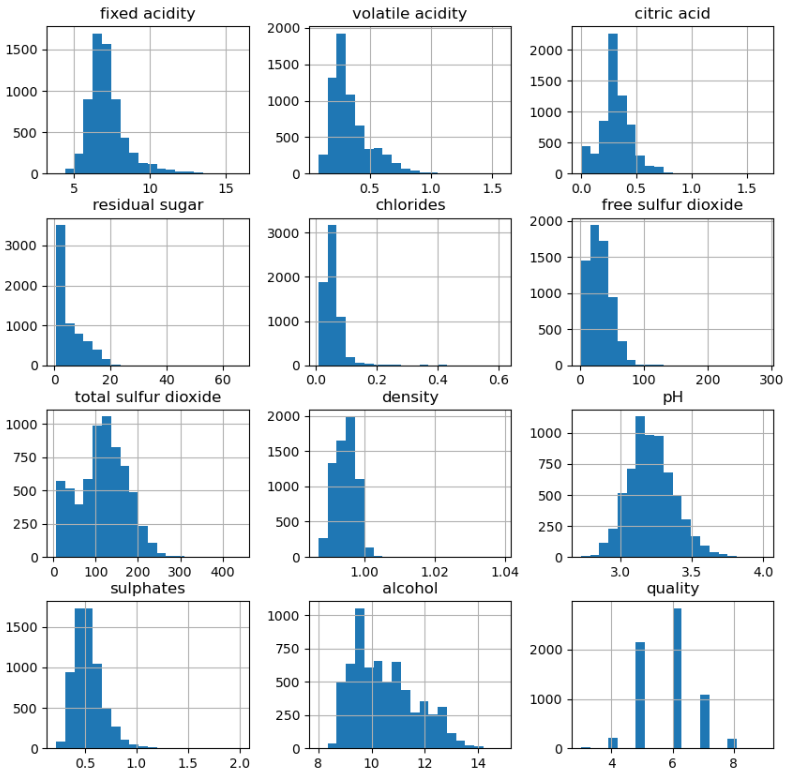
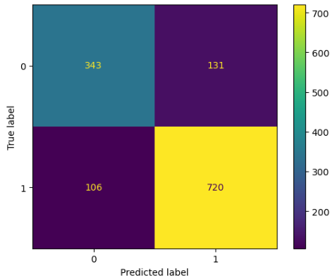

# Wine Quality Prediction Using Machine Learning

## Project Overview

Developed a machine learning-based classification system to predict wine quality using physicochemical properties such as acidity, residual sugar, sulphur dioxide concentration, density, and alcohol content.

The project explores the relationship between chemical characteristics and wine quality and compares multiple classification algorithms to identify the most effective prediction model.

## Dataset Description

The dataset contains physicochemical measurements of wine samples, with quality scores assigned by human tasters serving as the target variable.

| Feature | Description |
|---|---|
| Fixed Acidity | Amount of nonvolatile acids |
| Volatile Acidity | Amount of acetic acid |
| Citric Acid | Concentration of citric acid |
| Residual Sugar | Amount of sugar remaining after fermentation |
| Chlorides | Salt concentration |
| Free Sulphur Dioxide | Free form of sulphur dioxide |
| Total Sulphur Dioxide | Total sulphur dioxide concentration |
| Density | Density of the wine |
| pH | Acidity or basicity level |
| Sulphates | Sulphate concentration |
| Alcohol | Alcohol percentage |
| Quality | Wine quality score (0–10) |

## Methodology

### 1. Data Preprocessing

- Checked the dataset for missing values and duplicate records.
- Applied feature scaling to standardize numerical attributes.
- Split the dataset into training and testing subsets for model development and evaluation.

### 2. Exploratory Data Analysis (EDA)

- Examined the distribution of physicochemical properties across wine samples.
- Analyzed correlations between chemical attributes and wine quality.
- Used statistical analysis and visualizations to identify patterns influencing wine quality.

**Feature Distribution:**



### 3. Model Development

Implemented and compared the following supervised machine learning algorithms:

1. **Logistic Regression:** Used as a baseline classification model.
2. **Support Vector Machine (SVM):** Applied to classify wine samples using optimized decision boundaries.
3. **XGBoost:** Used gradient-boosted decision trees to capture complex relationships between physicochemical properties and wine quality.

### 4. Model Evaluation

Evaluated the performance of the classification models using:

- Accuracy
- Precision
- Recall
- F1-score

Confusion matrices were also generated to analyze classification performance and identify prediction errors across quality categories.

**Confusion Matrix:**



## Results and Discussion

The models were evaluated on the test dataset, and their performance is summarized below:

| Model | Accuracy | Precision | Recall | F1-Score |
|---|---:|---:|---:|---:|
| Logistic Regression | 74% | 72% | 69% | 70% |
| **XGBoost** | **82%** | **81%** | **80%** | **81%** |
| SVM | 75% | 73% | 70% | 70% |

### Key Findings

- XGBoost achieved the highest classification accuracy of **82%** among the three evaluated models.
- XGBoost also demonstrated better precision, recall, and F1-score compared to Logistic Regression and SVM.
- The results highlight the effectiveness of ensemble-based learning techniques in capturing complex relationships within the dataset.

## Technologies Used

| Category | Tools / Libraries |
|---|---|
| Programming Language | Python 3.8+ |
| Data Processing | Pandas, NumPy |
| Data Visualization | Matplotlib, Seaborn |
| Machine Learning | Scikit-learn, XGBoost |
| Development Environment | Jupyter Notebook |

## Installation and Execution

### 1. Clone the Repository

```bash
git clone https://github.com/AShr12xz/Wine_Quality_Prediction.git
cd Wine_Quality_Prediction
```

### 2. Install Dependencies

```bash
pip install pandas numpy scikit-learn matplotlib seaborn xgboost
```

### 3. Run the Project

Open the Jupyter Notebook:

```bash
jupyter notebook Wine_Quality_Prediction.ipynb
```

Execute the notebook cells sequentially to perform data preprocessing, exploratory data analysis, model training, and evaluation.

## Conclusion

This project demonstrates the application of supervised machine learning techniques to wine quality classification. By comparing Logistic Regression, SVM, and XGBoost, the study identifies XGBoost as the best-performing model among the evaluated approaches.

The project provides practical exposure to data preprocessing, exploratory data analysis, classification algorithms, and model evaluation.

---
